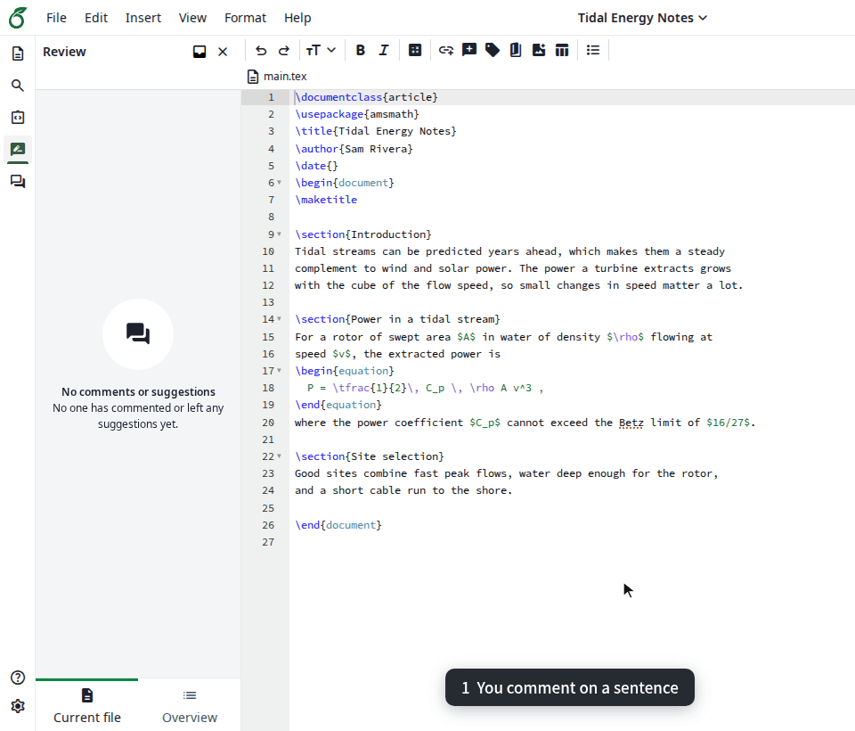
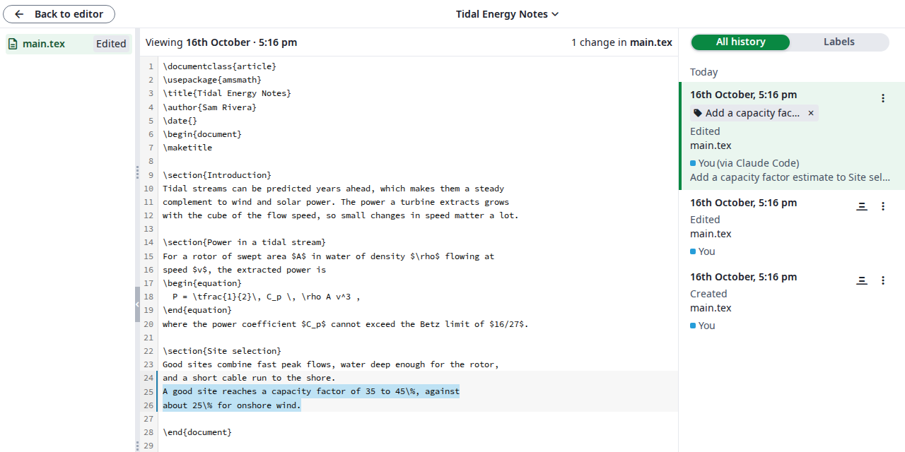
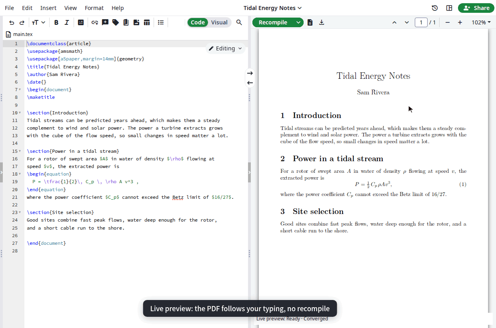
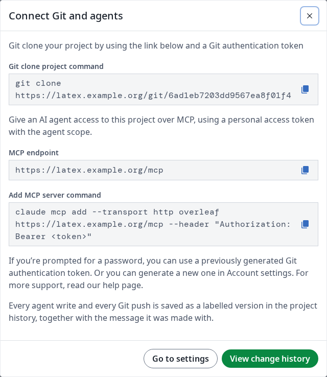

<h1 align="center">Interleaf</h1>

<h4 align="center">A fork of Overleaf Community Edition where an AI agent is a first-class collaborator.</h4>

<p align="center">
  <a href="#what-this-adds">What this adds</a> •
  <a href="#quick-start">Quick start</a> •
  <a href="#documentation">Documentation</a> •
  <a href="#relationship-to-overleaf">Relationship to Overleaf</a> •
  <a href="#acknowledgements">Acknowledgements</a> •
  <a href="#license">License</a>
</p>

Overleaf Community Edition is a collaborative LaTeX editor built for people
sitting in front of a browser. Interleaf keeps all of that and adds the two
things an agent needs in order to work on the same document as those people: a
machine-usable interface, and a shared history where a human can see what the
agent did and undo it.

The name is the point. Interleaving is what happens when an agent and an author
take turns on the same pages: the agent proposes, the human reads the margin
notes, accepts some of it, and the timeline records both hands.

## What this adds

### An agent in the review loop



You comment in the review panel as usual. The agent picks the thread up over
MCP with `list_comments`, answers with `reply_comment` and offers the fix with
`suggest_edits`, which lands as a tracked change under the agent's own account
(`Agent MCP` here). Nothing changes in the document until you accept it.

### Every agent write in the history



A write says which client made it and why. The history panel shows that under
the author line, a write can carry a label so it is easy to return to, and
`revert_to` takes the project back to any version.

### Live preview while you type



LuaLaTeX projects get a live PDF: the paragraph you are editing is re-typeset
within a fraction of a second, and a background pass settles the pages.

### Git and MCP from one dialog



Each project shows its `git clone` URL and the command that connects an MCP
client such as Claude Code. Both authenticate with a personal access token from
Account settings.

### The full list

- **A built-in MCP endpoint** at `POST /mcp`, spoken by any Model Context
  Protocol client. An agent reads and writes files, follows the history, opens
  and merges branches, reads review comments and replies to them, and offers
  edits as tracked changes for a person to accept or reject. It is stateless
  and authenticated with a personal access token. Writes are guarded: replacing
  an existing file needs an explicit `overwrite`, a stale version is refused
  with the current one, and every error says what to do next.
- **Comment-driven collaboration.** Upstream's review panel exists in the
  Community Edition source but is switched off. Interleaf turns it on, adds the
  web routes it needs, and gives an agent a service account of its own, so a
  comment thread reads as a conversation between named participants. Comments
  survive rewrites of the text they are anchored to.
- **A readable change history.** Every agent write carries the name of the
  client and the message it sent, shown under the author line in the history
  panel. Labels stay what they are upstream, milestones a human chose, rather
  than one label per machine edit.
- **Git access on Community Edition.** The web half of the official Java
  git-bridge, so `git clone` and `git push` work against a project. Upstream
  ships the bridge itself under the MIT licence but keeps the web adapter in
  Server Pro; this one is written from scratch.
- **One-way GitHub backup.** Link a project to a repository and its history is
  mirrored there on a schedule or on demand, fast-forward only, with the tokens
  encrypted at rest.
- **Live preview for LuaLaTeX projects.** Paragraphs are re-typeset as you type
  and drawn over the PDF within a fraction of a second, for edits made by you,
  a collaborator, an agent or a `git push` alike; a background pass settles
  pages, floats and references. It is built on
  [realtime-tex](https://github.com/HenryXiaoYang/realtime-tex) and works for
  Chinese with `ctex`. pdfLaTeX and XeLaTeX projects compile as before.
- **The full TeX Live in the image.** Upstream's image ships `scheme-basic`;
  Interleaf ships `scheme-full`, so conference templates such as `acmart` and
  `IEEEtran` compile without installing anything.

## Quick start

Interleaf is a drop-in replacement for the `sharelatex/sharelatex` image, so the
[Overleaf Toolkit](https://github.com/overleaf/toolkit) is the shortest path.
The images are published to the GitHub Container Registry:

| Image | Contents |
|---|---|
| `ghcr.io/zack-will/interleaf:<tag>` | Community Edition, this fork's modules, rtex and the full TeX Live |
| `ghcr.io/zack-will/git-bridge:<tag>` | The MIT-licensed Java Git server, built from `services/git-bridge` |

Image tags look like Overleaf versions (`6.2.5`) because the toolkit insists on
that shape and derives the git-bridge tag from it. Interleaf's own releases are
the git tags `interleaf-vX.Y.Z`; each [release](https://github.com/Zack-Will/interleaf/releases)
names the image tag it ships, and [`CHANGELOG.md`](CHANGELOG.md) lists what
changed.
See [`doc/deploy-toolkit.md`](doc/deploy-toolkit.md) for the full runbook,
including the one patch the toolkit needs before it will run git-bridge outside
Server Pro.

For a development stack that reloads on code changes, see
[`doc/design/dev-environment.md`](doc/design/dev-environment.md).

Connect an agent once the server is up:

```bash
claude mcp add --transport http interleaf https://your-host/mcp \
  --header "Authorization: Bearer olp_your_token"
```

## Documentation

| Document | What it covers |
|---|---|
| [`doc/agent-sync-usage.md`](doc/agent-sync-usage.md) | Enabling the features, tokens, the MCP tools, the comment workflow, Git |
| [`doc/github-backup.md`](doc/github-backup.md) | Linking a project to GitHub and what the statuses mean |
| [`doc/live-preview.md`](doc/live-preview.md) | Turning live preview on, what updates live, and its limits |
| [`doc/deploy-toolkit.md`](doc/deploy-toolkit.md) | Building the image and rolling it out with the Overleaf Toolkit |
| [`doc/changes-from-ce.md`](doc/changes-from-ce.md) | Every change this fork makes to Community Edition, file by file |
| [`CHANGELOG.md`](CHANGELOG.md) | What each release changed |
| [`doc/design/agent-sync-architecture.md`](doc/design/agent-sync-architecture.md) | Why the design looks like this, and the decisions behind it |
| [`doc/design/github-backup.md`](doc/design/github-backup.md) | The mirror job, its data model and its failure modes |
| [`doc/design/live-preview.md`](doc/design/live-preview.md) | The live preview service, its protocol and its resource budget |
| [`AGENTS.md`](AGENTS.md) | Conventions for anyone, human or agent, changing this repository |

## Relationship to Overleaf

Interleaf is an independent fork of
[overleaf/overleaf](https://github.com/overleaf/overleaf). It is **not**
affiliated with, endorsed by, or supported by Overleaf. Overleaf and ShareLaTeX
are trademarks of their respective owners; this project uses those names only to
say where it came from.

Everything here is either upstream's own open-source code or written from
scratch against public interfaces. No Server Pro source was used. The
interfaces the new modules implement come from the MIT-licensed
[`services/git-bridge`](services/git-bridge) in this same repository and from
the Community Edition code around them.

If you want a supported product with a warranty behind it, buy
[Overleaf Server Pro](https://www.overleaf.com/for/enterprises). Their revenue
is what pays for the Community Edition this fork is built on.

The upstream README is kept at
[`doc/README.overleaf.md`](doc/README.overleaf.md).

> [!CAUTION]
> This inherits the Community Edition security model: it is meant for
> environments where **all** users are trusted. Without sandboxed compiles a
> user can read and write the container's filesystem, network and environment
> during a LaTeX compile. Giving an agent write access does not change that
> boundary, it just means a program is now standing inside it. Live preview
> runs a LuaLaTeX process per open project inside the same container and the
> same boundary.

## Acknowledgements

Interleaf exists because other people gave their work away.

- **The Overleaf team and the ShareLaTeX authors** wrote the editor, the
  real-time collaboration, the history system and nearly everything else this
  repository contains, and keep publishing it as free software.
- **Winston Li** wrote the [git-bridge](services/git-bridge) that Git access is
  built on, and released it under the MIT licence.
- **Henry Yang and the realtime-tex contributors** wrote
  [realtime-tex](https://github.com/HenryXiaoYang/realtime-tex), the engine
  behind live preview. Interleaf builds it from a fork whose fixes are offered
  back upstream.
- **The TeX Live team and every package author** on CTAN, whose work is the
  bulk of the image.
- **[OverleafMCP](https://github.com/mjyoo2/OverleafMCP)** by mjyoo2 and
  **[olgitbridge](https://github.com/chazeon/olgitbridge)** by chazeon showed
  what agents and Git users need from an Overleaf server before this fork
  started. No code was taken from them.

Credit to the [linux.do](https://linux.do) community.

[`NOTICE.md`](NOTICE.md) lists every bundled component with its licence.

## Contributing

See [`CONTRIBUTING.md`](CONTRIBUTING.md) for upstream's process, which applies
to anything that belongs upstream. For this fork, open an issue first; changes
that make agent collaboration clearer are welcome, changes that diverge from
upstream for no reason are not.

## License

GNU Affero General Public License, version 3, the same as upstream. A copy is in
[`LICENSE`](LICENSE).

Copyright (c) Overleaf, 2014-2025, for the upstream work.
Copyright (c) the Interleaf contributors, 2026, for the changes in this fork.

Bundled components keep their own licences, listed in [`NOTICE.md`](NOTICE.md):
[`services/git-bridge`](services/git-bridge) and realtime-tex are MIT, TeX Live
is a collection of free licences per package. The images carry each licence
text next to the component.

Because this is AGPL software, anyone you let use a server running it is
entitled to its source. If you deploy a modified copy, publish your changes and
link to them from the running instance.
